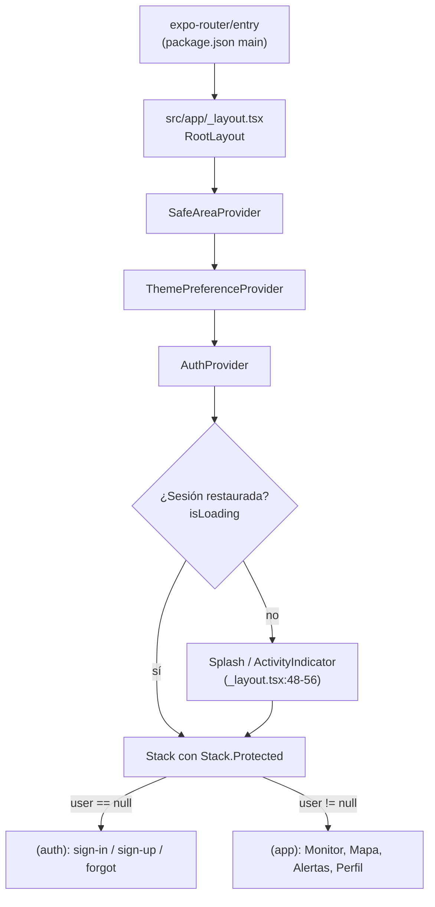

# Arquitectura

Cómo está organizado SismoConnect, qué reglas sigue el código y qué ocurre desde que el usuario toca el icono hasta que ve la primera pantalla.

## [Volver al README](../README.md)

---

## 1. Principio rector

**Cada capa tiene una responsabilidad y no se salta a la siguiente:**

```
Pantalla (src/app)          → decide QUÉ se muestra y cuándo
   ↓
Hook (src/hooks)            → estado + efectos (subscriptions, polling)
   ↓
Servicio (src/services)     → un backend concreto (USGS, Firestore)
   ↓
Lib/Config (src/lib, src/constants) → acceso a SDKs y credenciales
```

Ejemplo real: `alerts.tsx` (pantalla) llama a `useFirestoreAlerts()` (hook), que llama a `subscribeToCollection()` (servicio), que usa `getFirebaseFirestore()` (lib). La pantalla **nunca** importa `firebase/firestore` directamente: solo `use-alerts.ts` y `firestore.ts` lo hacen.

Excepción deliberada: `use-alerts.ts` importa `where` de `firebase/firestore` porque necesita un operador de query; es el único hook que toca el SDK.

---

## 2. Flujo de arranque



Puntos clave de `src/app/_layout.tsx`:

1. **Providers anidados** (líneas 19-27): el orden importa — `AuthProvider` necesita el tema ya montado para pintar el cargador, y ambos necesitan `SafeAreaProvider`.
2. **Splash retenido** (línea 16 `preventAutoHideAsync`, líneas 44-46 `hideAsync`): la pantalla nativa no se libera hasta que Firebase restaura la sesión persistida, así no aparece un destello de la pantalla de login a usuarios que ya iniciaron sesión.
3. **Un frame extra** (líneas 38-42): `setTimeout(…, 0)` tras `isLoading=false` para que el navegante esté montado antes de ocultar el splash (evita un frame en blanco en Android).
4. **Guards declarativos** (líneas 67-72):

   ```tsx
   <Stack.Protected guard={!user}>
     <Stack.Screen name="(auth)" />
   </Stack.Protected>
   <Stack.Protected guard={!!user}>
     <Stack.Screen name="(app)" />
   </Stack.Protected>
   ```

   No hay `router.push` de éxito en ningún login: cuando `user` cambia, Expo Router **reemplaza el árbol** completo. Por eso `sign-in.tsx:33` comenta *"No navigation on success"*.

---

## 3. Navegación

```
src/app/
├── _layout.tsx          Stack raíz + providers + guards
├── (auth)/              grupo de autenticación (header oculto)
│   ├── _layout.tsx      Stack con headerShown: false
│   ├── sign-in.tsx      → /sign-in
│   ├── sign-up.tsx      → /sign-up
│   └── forgot-password.tsx
├── (app)/               grupo de la app (tabs)
│   ├── _layout.tsx      NativeTabs (tabs nativas de sistema)
│   ├── index.tsx        → pestaña "Monitor"
│   ├── map.tsx          → pestaña "Mapa"
│   ├── alerts.tsx       → pestaña "Alertas"
│   ├── profile.tsx      → pestaña "Perfil"
│   └── firestore-test.tsx  pantalla sin pestaña (se llega con router.push)
├── +not-found.tsx       ruta desconocida
└── +html.tsx            plantilla HTML de la versión web
```

- `(auth)` y `(app)` son **grupos de rutas**: los paréntesis no añaden segmento de URL.
- El tab bar usa `expo-router/unstable-native-tabs` (`(app)/_layout.tsx`): en Android pestañas nativas de Material, en iOS/web cae a `sf`/`md`/fallback. Cada pestaña se declara con `NativeTabs.Trigger name="..."`.
- `_layout.web.tsx` existe como variante web del layout de tabs (mismo patrón de platform files que el resto).
- Las rutas tipadas (`experiments.typedRoutes` en `app.json`) hacen que `href="/sign-up"` sea validado por TypeScript.

---

## 4. Convenciones de código

| Convención | Ejemplo |
|---|---|
| Alias `@/` → `src/` | `import { useAuth } from '@/providers/auth-provider'` (`tsconfig.json:6`) |
| Un componente/pantalla por archivo | `card.tsx` exporta `Card` |
| Archivos platform-specific | `firebase.native.ts` / `firebase.web.ts`, `quake-map.tsx` / `quake-map.web.tsx`, `use-color-scheme.ts` / `.web.tsx` — Metro elige el correcto según plataforma |
| Pantallas = default export | `export default function AlertsScreen()` |
| Componentes = named export | `export function Card(...)` |
| Estilos al final con `StyleSheet.create` | tokens `Spacing`, `Radius`, `MaxContentWidth` de `constants/theme.ts` |
| Sin estilos inline "a ojo" | colores siempre desde `useTheme()` |
| Estado asíncrono con estados explícitos | `{ loading, refreshing, error, data }` en vez de promesas sueltas |
| Comentarios JSDoc en español en el código de dominio | `use-storage.ts`, `firestore.ts` |
| Accesibilidad | `accessibilityRole`, `accessibilityLabel` en toda la UI interactiva |
| Háptica al interactuar | `haptics.tap()/select()/success()/error()` (`lib/haptics.ts`) |

---

## 5. Gestión de estado

| Tipo | Dónde | Ejemplos |
|---|---|---|
| **Contexto global** | `providers/`, `hooks/` con `createContext` | `AuthProvider` (sesión), `ThemePreferenceProvider` (tema) |
| **Estado local de pantalla** | `useState` en `src/app/*.tsx` | filtros, texto del buscador, modal abierto |
| **Estado compartido vía hook** | `hooks/` | `useEarthquakes` (datos USGS), `useFirestoreAlerts` (Firestore) |
| **Persistencia local** | AsyncStorage con `use-storage.ts` | tema (`sismoconnect:theme`), historial (`sismoconnect:viewed`), invitado local (`sismoconnect:guest`) |
| **Persistencia remota** | Firestore | colección `alertas` (documentos del usuario) |
| **Sesión** | Firebase Auth (persistencia propia en AsyncStorage/browser) | restaurada por `onAuthStateChanged` |

No hay librería de estado global (Redux/Zustand): el proyecto es deliberadamente pequeño y cubre todos los casos con Context + hooks.

### Ciclo de vida de un dato remoto

```
USGS:   mount → fetch → state → (60 s) → fetch → state     [polling en use-earthquakes.ts:76-80]
Firestore: mount → onSnapshot → state ← onSnapshot ← cambio en cualquier cliente  [tiempo real]
```

La diferencia es el requisito de la guía de clase: Firestore usa `onSnapshot` y devuelve `unsubscribe` para limpiar el listener (`use-alerts.ts:57-80`).

---

## 6. Degradación graceful

El proyecto está pensado para arrancar en un checkout limpio **sin credenciales**:

| Falta… | Comportamiento |
|---|---|
| `.env` | `isFirebaseConfigured = false` (`constants/config.ts:16`); el login por correo muestra aviso y se deshabilita, Google muestra un aviso, y se puede entrar como **invitado local** (`local-guest`) que guarda historial en el dispositivo. |
| Sin sesión de Firebase | El grupo `(app)` está tras el guard: no hay acceso. El invitado local sí tiene `user`, así que sí entra (es un usuario "falso" de solo dispositivo). |
| Red / USGS caído | `ErrorState` con botón "Reintentar" en Monitor, Mapa y Alertas. |
| Reglas de Firestore negando | `useFirestoreAlerts` captura el error del listener y muestra `ErrorState` en la sección "Mis alertas"; el resto de la pantalla sigue funcionando. |

---

## 7. Documentación relacionada

- [configuracion.md](configuracion.md) — cómo se configuran las capas bajas (`.env`, Firebase, Expo).
- [autenticacion.md](autenticacion.md) — el provider que protege los guards.
- [datos-sismos.md](datos-sismos.md) — el otro servicio remoto (USGS).
- [interfaz-y-temas.md](interfaz-y-temas.md) — el sistema de componentes y tokens.
