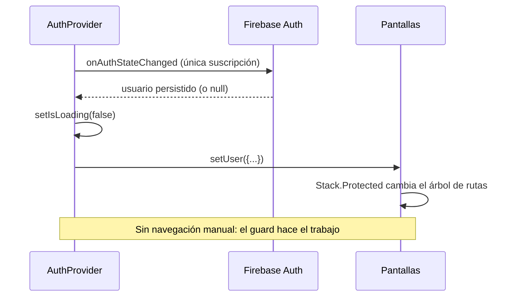

# Autenticación

Cómo funciona el acceso de usuarios en SismoConnect: el contexto único de sesión, los tres modos de entrada, la verificación de correo y cómo se protegen las rutas.

## [Volver al README](../README.md)

> La autenticación **ya está completa y no se toca** al trabajar en Firestore. Este documento explica lo que existe.

---

## 1. El contexto único: `AuthProvider`

`src/providers/auth-provider.tsx` es el **único** lugar que suscribe `onAuthStateChanged` (línea 88). No hay otro AuthContext ni otro listener de sesión en el proyecto.

### Estado que expone

```ts
type AppUser = {           // "vista recortada" del usuario de Firebase
  uid: string;
  email: string | null;
  displayName: string | null;
  isAnonymous: boolean;
  emailVerified: boolean;
};

type AuthContextValue = {
  user: AppUser | null;
  isLoading: boolean;      // true hasta restaurar la sesión (evita destello de login)
  isConfigured: boolean;   // false si falta .env
  isLocalGuest: boolean;   // true solo para el invitado local 'local-guest'
  signInWithEmail / signUpWithEmail / signInAsGuest / sendResetEmail
  resendVerification / signOut;
};
```

Uso en cualquier pantalla:

```ts
const { user, signOut } = useAuth();
```

### Ciclo de sesión



Detalle importante (líneas 104-112): si **no** hay Firebase configurado, el provider no se queda colgado — consulta AsyncStorage de la clave `sismoconnect:guest` y decide el usuario local (o `null`).

---

## 2. Los tres modos de sesión

| Modo | Cuándo | Backend | Persistencia | Firestore |
|---|---|---|---|---|
| **Correo + contraseña** | `.env` presente | Firebase Auth (`createUserWithEmailAndPassword` / `signInWithEmailAndPassword`) | AsyncStorage (native) / browser (web) vía `initializeAuth` | ✅ |
| **Google** | `.env` + `EXPO_PUBLIC_GOOGLE_CLIENT_ID` + dev build | OAuth (`expo-auth-session`) → `signInWithCredential` | igual que el anterior | ✅ |
| **Invitado Firebase** | `.env` presente y pulsar "Continuar como invitado" | `signInAnonymously` — uid anónimo real | sesión de Firebase | ✅ (`request.auth != null` se cumple) |
| **Invitado local** | **sin** `.env` | Ninguno: uid ficticio `local-guest` en AsyncStorage | `sismoconnect:guest` | ❌ (deshabilitado en la UI) |

La distinción clave: `isLocalGuest` (`auth-provider.tsx:141`) marca al invitado de solo-dispositivo. Ese usuario **no** tiene sesión de Firebase, así que no puede leer ni escribir en Firestore — por eso `useFirestoreAlerts` lo excluye (`use-alerts.ts:54`).

---

## 3. Pantallas del grupo `(auth)`

Las tres comparten `components/auth/auth-screen.tsx`, un "chrome" reutilizable: `KeyboardAvoidingView` (con `behavior="padding"` en iOS), `ScrollView` con `keyboardShouldPersistTaps="handled"`, logo "S", título/subtítulo y slot `footer` para links.

### `sign-in.tsx`

- Valida con `validateEmail` + `validatePassword` **antes** de llamar a Firebase (errores por campo en los `TextField`).
- `run(task)` centraliza el ciclo busy/error/haptics (líneas 29-41).
- Botón "Iniciar sesión" deshabilitado si `!isConfigured`.
- Separador "o" + `GoogleSignInButton` (línea 116) solo si hay configuración.
- "Continuar como invitado" → `signInAsGuest()`.
- Link a "¿Olvidaste tu contraseña?".

### `sign-up.tsx`

- Tercer campo "Repite la contraseña" con validación de coincidencia (línea 31).
- `signUpWithEmail` crea la cuenta **y** envía el correo de verificación (`auth-provider.tsx:123-128`).
- Nota legal: "Te enviaremos un correo para verificar tu cuenta".

### `forgot-password.tsx`

- `sendResetEmail` de Firebase.
- Estado `sent` que reemplaza el formulario por un `Card` de confirmación con lenguaje deliberadamente ambiguo ("Si existe una cuenta con ese correo…") para no filtrar qué correos existen.
- Botón "Enviar de nuevo" reutiliza el mismo handler.

---

## 4. Inicio de sesión con Google

`components/auth/google-sign-in-button.tsx` (variante `.web.tsx` para navegador):

1. `Google.useAuthRequest` con `ResponseType.IdToken` — flujo **implicit** que no necesita client secret en el bundle (líneas 18-24, 35).
2. Al volver del navegador, si `response.type === 'success'`, toma el `id_token` (líneas 46-50).
3. `GoogleAuthProvider.credential(idToken)` → `signInWithCredential(getFirebaseAuth(), credential)` (líneas 55-56): el token de Google se canjea por una sesión **de Firebase**, así después del login con Google el usuario es "authenticated" para Firestore igual que con correo.
4. Sin `googleClientId` muestra un aviso en vez del botón (líneas 67-75).

Requisito: **development build** (`npx expo run:android`); en Expo Go el redirect OAuth no completa (comentario en líneas 31-32).

---

## 5. Verificación de correo y errores

- Tras registrarse, `sendEmailVerification(credential.user)` envía el correo (`auth-provider.tsx:126`).
- `profile.tsx:96-104` muestra la tarjeta "Verifica tu correo" cuando `user && !isAnonymous && !emailVerified`, con botón "Reenviar correo" (`resendVerification` → `sendEmailVerification(firebaseUser.current)`).
- **La app no bloquea** por correo no verificado: solo insiste (decisión de UX, no de seguridad).

### Errores amigables

`utils/validation.ts → friendlyAuthError(error)` traduce códigos de Firebase a mensajes en español sin revelar si la cuenta existe:

| Código Firebase | Mensaje |
|---|---|
| `auth/invalid-credential`, `wrong-password`, `user-not-found` | "Correo o contraseña incorrectos." |
| `auth/email-already-in-use` | "Ese correo ya tiene una cuenta. Inicia sesión." |
| `auth/weak-password` | "Elige una contraseña más segura (mínimo 6 caracteres)." |
| `auth/too-many-requests` | "Demasiados intentos. Espera unos minutos." |
| `auth/network-request-failed` | "Sin conexión con el servidor. Revisa tu red." |

Validación local: `validateEmail` (regex deliberadamente laxa — "Firebase owns real verification") y `validatePassword` (≥ 6 caracteres, que es además el mínimo de Firebase).

---

## 6. Cierre de sesión

`profile.tsx → onSignOut()`:

1. `signOut()` del contexto → `fbSignOut(getFirebaseAuth())` si hay Firebase, y `AsyncStorage.removeItem('sismoconnect:guest')` para el invitado local (`auth-provider.tsx:150-157`).
2. `clear()` borra el historial local de sismos vistos (el historial es "del dispositivo", no de la cuenta).
3. **No hay navegación**: al ponerse `user = null`, el guard `!user` muestra el grupo `(auth)` automáticamente.

---

## 7. Relación con Firestore

- Las reglas de Firestore exigen `request.auth != null`; cualquier sesión de Firebase (correo, Google o **anónima**) la cumple.
- El invitado **local** (`local-guest`) no: su sección "Mis alertas" muestra un aviso y no hace ninguna llamada (`use-alerts.ts:54-55`).
- No hay `uid` en el token de seguridad "extra": los documentos de la colección `alertas` guardan `userId` y el hook filtra por él (ver [firestore.md](firestore.md)).

## 8. Documentación relacionada

- [configuracion.md](configuracion.md) — de dónde salen las credenciales.
- [firestore.md](firestore.md) — cómo consume Firestore esta sesión.
- [arquitectura.md](arquitectura.md) — los guards de ruta.
